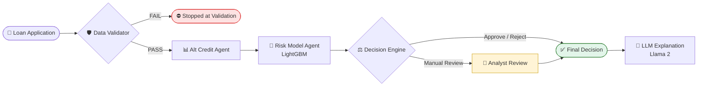

<div align="center">

# 🏦 Agentic Credit Underwriting System

**A multi-agent AI pipeline that validates, scores, decides on and explains loan applications, with a human analyst in the loop for borderline cases.**


[Overview](#-overview) · [Architecture](#-architecture) · [Agents](#-agents) · [Risk Model](#-risk-model) · [Results](#-scenario-testing) · [Quick Start](#-quick-start) · [Roadmap](#-roadmap)

</div>

---

## 📌 Overview

Credit underwriting has to balance three things: catching risky borrowers, approving good ones quickly, and being able to explain every decision to customers, auditors and regulators.

This project splits that work across **specialised AI agents**, each responsible for one stage of the underwriting process, coordinated as a **LangGraph state graph**:

- 🛡️ **Validates** each application, screens it for fraud and blocks prompt-injection text before any scoring
- 📊 **Scores** affordability with an alternative credit signal and default risk with a **LightGBM** model
- ⚖️ **Decides** using transparent business rules, and sends uncertain cases to a **human analyst**
- 💬 **Explains** each outcome in plain language with a **locally hosted LLM** that never changes the decision
- 🧾 **Traces** every agent's output so any decision can be audited end to end

---

## 🧭 Architecture



**Design principles**

| Principle | How it is applied |
|---|---|
| **Fail fast** | Validation runs first. A failed check ends the graph before any model or LLM call is made. |
| **One agent, one job** | Each agent can be tested, replaced or tuned on its own. |
| **Explainable by design** | Decisions come from readable rules, not from the LLM. The LLM explains the outcome and never sets it. |
| **Human in the loop** | Cases between the approve and reject thresholds pause for an analyst. |
| **Auditable** | Every step's output is recorded in an execution trace. |

---

## 🤖 Agents

### 🛡️ Data Validator
The gatekeeper for every application.
- Checks that required fields (`SK_ID_CURR`, `AMT_CREDIT`, `AMT_INCOME_TOTAL`) are present
- Detects **prompt-injection** text in input fields before it can reach downstream agents or the LLM
- Looks up the applicant on a **fraud watchlist** and stops the application if the fraud score is above 0.7

### 📊 Alt Credit Agent
Gives a second view of creditworthiness that does not depend on the model.
- Computes the **income-to-credit ratio**, a direct measure of affordability
- Converts it into an **alternative credit score** between 0 and 1

### 🤖 Risk Model Agent
The statistical core of the pipeline.
- Runs a trained **LightGBM** classifier to estimate the **probability of default**
- Builds the same engineered features at prediction time as at training time, so the two always match

### ⚖️ Decision Engine
Turns scores into a business action using transparent rules:

| Condition | Decision |
|---|:---:|
| Probability of default **< 5%** and alt credit score **> 0.6** | ✅ **Approve** |
| Probability of default **> 20%** | ❌ **Reject** |
| Everything in between | 👤 **Manual Review** |

### 💬 LLM Explanation Layer
- **Llama 2**, run locally through **Ollama**, so applicant data never leaves the machine
- A **few-shot prompt** (`prompts/explanation.md`) produces short, plain-language explanations
- The prompt tells the model **not to add new numbers**, which stops it from inventing figures

---

## 📈 Risk Model

| | |
|---|---|
| **Dataset** | [Home Credit Default Risk](https://www.kaggle.com/c/home-credit-default-risk) (`application_train.csv`) |
| **Target** | Loan default (`TARGET`) |
| **Algorithm** | LightGBM gradient-boosted trees |
| **Hyperparameters** | 150 estimators · learning rate 0.05 · max depth 6 |
| **Validation** | 80/20 random train/test split (`random_state=42`) |
| **Metrics** | Accuracy and ROC-AUC on the held-out test set |

**Features**

| Group | Features |
|---|---|
| Loan | `AMT_CREDIT`, `AMT_ANNUITY` |
| Applicant | `AMT_INCOME_TOTAL`, `DAYS_BIRTH`, `DAYS_EMPLOYED` |
| Credit bureau | `EXT_SOURCE_1`, `EXT_SOURCE_2`, `EXT_SOURCE_3` |
| Engineered | `income_credit_ratio` = income ÷ credit amount |

---

## 🔍 Sample Output

An illustrative trace for a low-risk applicant, showing the shape of the output from `python main.py`:

```json
{
  "validator":  { "status": "PASS", "reason": "Validation passed", "fraud_score": 0.1 },
  "alt_credit": { "alt_credit_score": 0.625, "income_credit_ratio": 0.625 },
  "risk":       { "p_default": 0.04, "model_used": "lightgbm" },
  "decision":   { "decision": "APPROVE", "reason": "Low default probability and good alternative credit score" }
}
```

> 💬 **LLM explanation:** *"The applicant has a low likelihood of default and their income comfortably supports the loan amount, so the application was approved."*

---

## 🧪 Scenario Testing

The full pipeline was run against five representative applicant profiles, covering normal cases, risky cases and adversarial input:

| Scenario | Outcome | What happened |
|---|:---:|---|
| 🟢 Happy path | ✅ Approve | Low default risk and strong affordability |
| 🔴 High risk | ⛔ Blocked | Fraud watchlist score above threshold, stopped at validation |
| 🟡 Medium risk | 👤 Manual Review | Default risk between the approve and reject thresholds |
| 🟠 Fraud case | 👤 Manual Review | Passed the watchlist check and routed to an analyst on risk score |
| 🟣 Prompt injection | ⛔ Blocked | Injection text detected in an input field, stopped at validation |

📄 Full results are in [`deliverables/scenario_test_results.json`](deliverables/scenario_test_results.json).

---

## 🚀 Quick Start

**1. Clone and install**
```bash
git clone https://github.com/anmolisb/CR.git
cd CR
python -m venv venv
source venv/bin/activate        # Windows: venv\Scripts\activate
pip install -r requirements.txt
```

**2. Add the dataset**

Download `application_train.csv` from [Kaggle](https://www.kaggle.com/c/home-credit-default-risk/data) and place it in `data/`.

**3. Train the risk model**
```bash
python load_data.py             # saves models/risk_model.pkl and prints accuracy and AUC
```

**4. Run the pipeline**
```bash
python main.py                  # one sample application through the full LangGraph pipeline
python run_scenarios.py         # all five test scenarios, with results saved to deliverables/
```

**5. (Optional) Enable LLM explanations**
```bash
# install Ollama from https://ollama.com, then:
ollama pull llama2
```

---

## 🗂️ Project Structure

```
CR/
├── agents/
│   ├── data_validator.py      # Required fields, injection and fraud checks
│   ├── alt_credit.py          # Affordability-based alternative credit score
│   ├── risk_model.py          # LightGBM default-probability prediction
│   └── decision_engine.py     # Approve / Reject / Manual Review rules
├── orchestrator/
│   ├── langgraph_pipeline.py  # LangGraph state graph with conditional routing
│   ├── pipeline.py            # Sequential pipeline with trace and analyst review
│   └── explanation.py         # LLM explanation layer (Llama 2 via Ollama)
├── tools/tools.py             # Fraud watchlist lookup and alt credit computation
├── prompts/explanation.md     # Few-shot prompt for decision explanations
├── evaluation/                # Agent-level evaluation scripts
├── deliverables/              # Scenario test outputs
├── docs/                      # Design document, run guide and sample trace
├── models/                    # Trained model artifact
├── load_data.py               # Data preparation and model training
├── main.py                    # Pipeline entry point
└── run_scenarios.py           # Scenario test suite
```

---

## 🛣️ Roadmap

- [ ] Connect the fraud watchlist to a real database instead of the in-memory sample
- [ ] Replace keyword-based injection checks with a classifier-based input guard
- [ ] Move decision thresholds into `configs/rules.yaml` so they can be tuned without code changes
- [ ] Expand features with bureau and previous-application data, and add probability calibration
- [ ] Add SHAP-based feature explanations to the LLM prompt for richer, grounded reasoning
- [ ] Serve the pipeline through a FastAPI endpoint with a simple analyst review UI

---

<div align="center">

**Built by [Anmol Jindal](https://www.linkedin.com/in/anmol-jindal-045330129)**

Fraud & Credit Risk Analytics · ISB AMPBA

</div>
